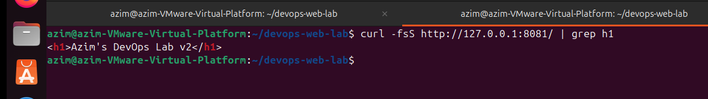
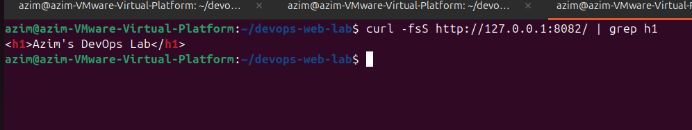

# Kubernetes rollout and rollback

I took my Podman and NGINX lab and ran it in MicroK8s on my Ubuntu VM. I deployed two replicas and added an HTTP readiness probe on port 80. It checks the home page before Kubernetes marks a pod ready.

## Deploy v1

Run these commands from the folder containing the Containerfile, nginx.conf, index.html, and deployment.yaml. This assumes Podman and MicroK8s are installed and the node is ready.

```bash
podman build -t localhost/azim-web:v1 .
podman save -o /tmp/azim-web-v1.tar localhost/azim-web:v1
sudo microk8s images import < /tmp/azim-web-v1.tar
sudo microk8s kubectl apply -f deployment.yaml
sudo microk8s kubectl rollout status deployment/azim-web --timeout=90s
```

In a second terminal, run the port-forward and leave it open.

```bash
sudo microk8s kubectl port-forward deployment/azim-web 8081:80
```

In the first terminal, run `curl -fsS http://127.0.0.1:8081/ | grep h1`. The heading is `Azim's DevOps Lab`.

## Deploy v2

I changed the heading in a separate copy of the HTML and built a new image.

```bash
mkdir -p v2
cp Containerfile nginx.conf v2/
sed 's/DevOps Lab/DevOps Lab v2/g' index.html > v2/index.html
podman build -t localhost/azim-web:v2 v2
podman save -o /tmp/azim-web-v2.tar localhost/azim-web:v2
sudo microk8s images import < /tmp/azim-web-v2.tar
sudo microk8s kubectl set image deployment/azim-web azim-web=localhost/azim-web:v2
sudo microk8s kubectl rollout status deployment/azim-web --timeout=90s
```

Start a fresh port-forward to the new pods. Run the curl check again. I got `<h1>Azim's DevOps Lab v2</h1>`.



## Roll back and check the page

I checked the rollout history and confirmed that revision 2 contained v1 and the readiness probe. Revision numbers can differ when repeating the lab.

```bash
sudo microk8s kubectl rollout history deployment/azim-web
sudo microk8s kubectl rollout history deployment/azim-web --revision=YOUR_V1_REVISION
```

Replace `YOUR_V1_REVISION` with the number for the revision that lists the v1 image and the readiness probe.

```bash
sudo microk8s kubectl rollout undo deployment/azim-web --to-revision=YOUR_V1_REVISION
sudo microk8s kubectl rollout status deployment/azim-web --timeout=90s
sudo microk8s kubectl get deployment azim-web -o wide
```

After the rollback I had 2/2 replicas ready, and the image column showed v1. I opened a fresh port-forward on 8082 and checked the page again.

```bash
# Run in the port-forward terminal
sudo microk8s kubectl port-forward deployment/azim-web 8082:80
```

```bash
# Run in the other terminal
curl -fsS http://127.0.0.1:8082/ | grep h1
```

The response was `<h1>Azim's DevOps Lab</h1>`. That confirmed the original page was back.




